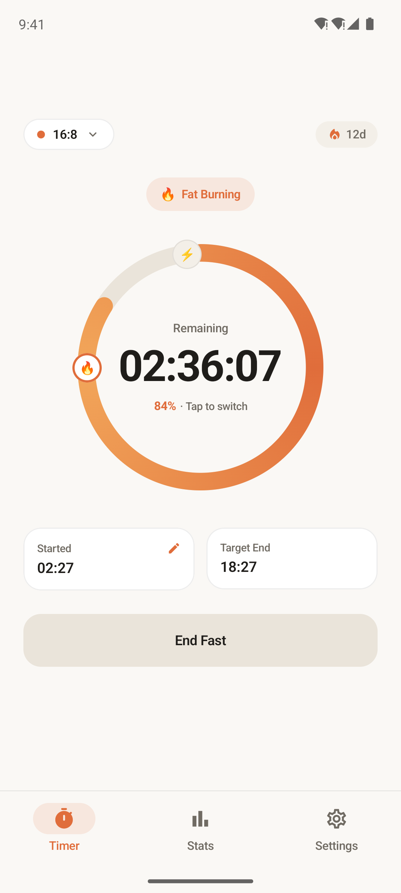
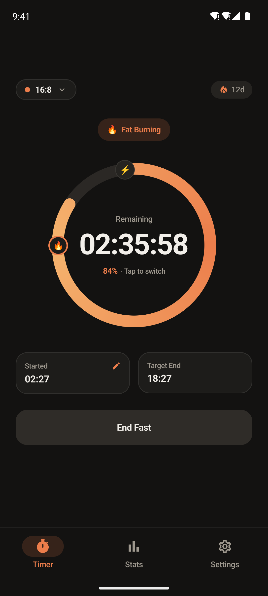
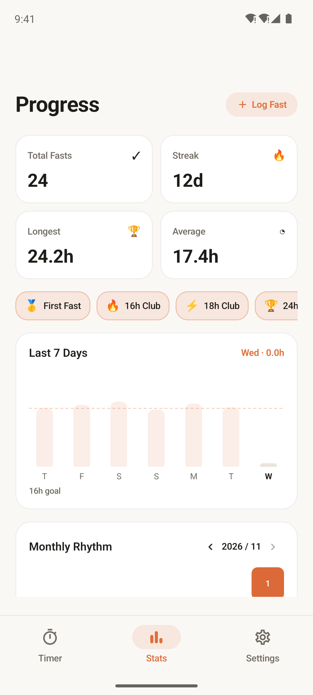
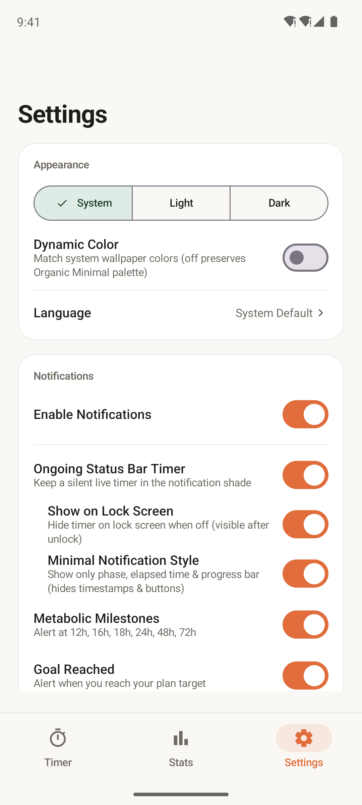

<div align="center">

# Fasting Tracker

**A calm, offline-first, open-source intermittent fasting tracker for Android.**

[](LICENSE)
[-3DDC84?logo=android&logoColor=white)](https://developer.android.com)
[](https://kotlinlang.org)
[](https://solocraft.app)

[English](README.md) · [简体中文](README_ZH.md) · [Website (solocraft.app)](https://solocraft.app/fasting-tracker) · [Privacy Policy](PRIVACY.md)

<br/>

<table>
  <tr>
    <td></td>
    <td></td>
    <td></td>
    <td></td>
  </tr>
</table>

</div>

---

## Why Fasting Tracker?

Most intermittent fasting apps have turned into bloated \$60–\$90/year subscriptions packed with ads, mandatory accounts, and data tracking.

**Fasting Tracker** is built around one belief: a fasting timer should be **quiet, accurate, private, and completely yours**.

- **100% Free & Open Source (GPL-3.0)** — No subscriptions, no paywalls, no ads.
- **Zero Tracking, Offline-First** — No accounts, no cloud sync, no analytics, no `INTERNET` permission. All data stays locally on your device with manual JSON export/import.
- **Organic Minimal Design** — Calm Material 3 UI with tabular numerals, clickable metabolic stage ring, weekly bar chart, monthly heatmap, and adaptive 2×2 / 4×2 Jetpack Glance widgets.
- **Android 16+ Live Updates & HyperOS Super Island** — Native `Notification.ProgressStyle` support with zero foreground service overhead, showing both **fasting** and **eating window** progress with dynamic stage icons, plus independent toggles for Live Update, Lock Screen visibility, and Minimal notification style.
- **Thoughtful Fasting Rules** — Built-in schedules (`14:10`, `16:8`, `18:6`, `20:4`, `24h`, `48h`, `72h`) + custom plans, automatic `< 1h` accidental-tap discard, natural overtime tracking, and non-overlapping history editing / manual logging.
- **Native Bilingual Support** — First-class English and Simplified Chinese with in-app per-app language switching.

---

## Distribution Flavors

Fasting Tracker builds two clean flavors from the same open-source codebase:

| Flavor | Distribution | Proprietary Dependencies | Voluntary Support |
| :--- | :--- | :--- | :--- |
| **`foss`** | GitHub Releases · F-Droid · `solocraft.app` | **None** (100% FOSS) | Opens `solocraft.app/fasting-tracker#support` in browser |
| **`play`** | Google Play Store | Google Play Billing only | In-app voluntary tip via Google Play Billing |

---

## Build from Source

Requirements: JDK 17, Android SDK (API 36).

```bash
# Run unit tests for both flavors
./gradlew :app:testPlayDebugUnitTest :app:testFossDebugUnitTest

# Build FOSS debug / release APK
./gradlew :app:assembleFossDebug
./gradlew :app:assembleFossRelease

# Build Google Play release AAB
./gradlew :app:bundlePlayRelease
```

---

## Tech Stack

- **UI**: Jetpack Compose, Material 3, Type-Safe Navigation Compose, Jetpack Glance Widgets
- **Architecture**: Clean Architecture + MVVM, Hilt DI, Coroutines & Flow
- **Storage**: Room SQLite (Schema v4), Jetpack DataStore, SAF JSON Backup
- **Scheduling & Notifications**: `AlarmManager`, WorkManager (`LiveUpdateRefreshWorker`), Android 16+ `Notification.ProgressStyle`

---

## Support & Credits

Part of [**SoloCraft**](https://solocraft.app) — minimal, privacy-first indie apps.  
If Fasting Tracker helps your daily routine, consider starring the repo or [buying the developer a coffee](https://solocraft.app/fasting-tracker#support).

Licensed under the [GNU General Public License v3.0](LICENSE).
